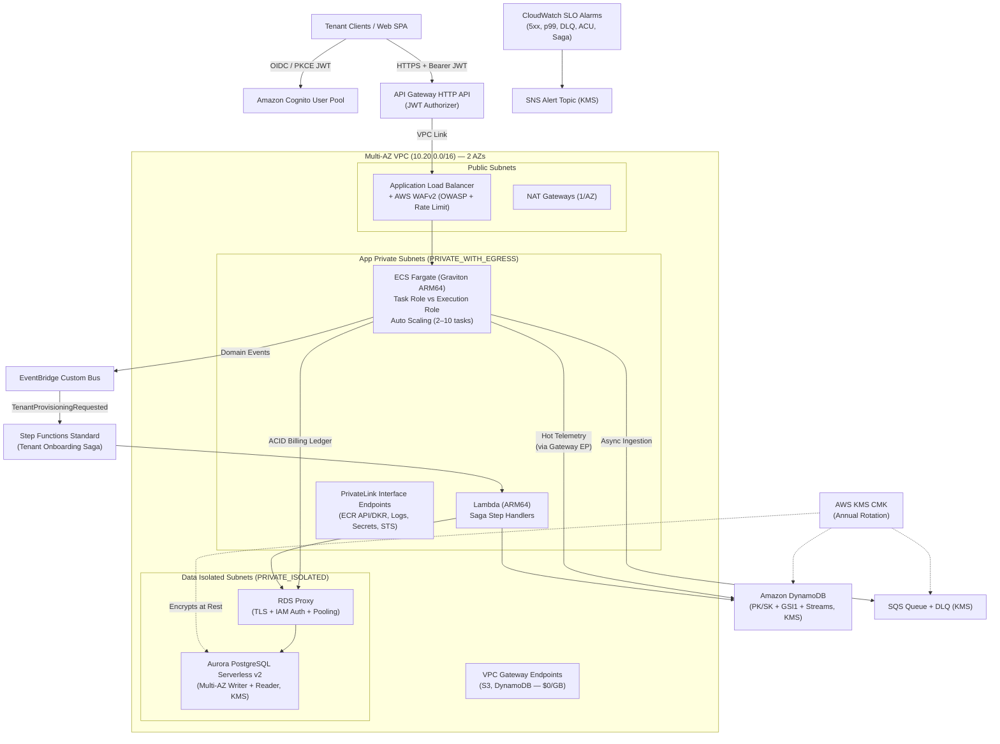

# CloudPulse — Multi-Tenant Production AWS SaaS Platform

**CloudPulse** is a resume-grade, production-architected multi-tenant B2B SaaS telemetry and billing platform on AWS. It demonstrates end-to-end Infrastructure as Code (AWS CDK v2 + Terraform), zero-trust networking, federated OIDC CI/CD with shift-left compliance (`cdk-nag`), polyglot persistence (DynamoDB + Aurora Serverless v2 via RDS Proxy), distributed Saga orchestration, and SLO-driven observability with automated canary rollback.

---

## 1. Architecture Diagram

### High-Level Topology (Mermaid)



### Network & Request Flow (ASCII)

```text
  [Client] ──▶ [Cognito OIDC] (mints JWT w/ tenant_id)
     │
     ▼
  [API Gateway HTTP API (JWT Auth)] ──(VPC Link)──▶ [ALB + WAFv2 (Rate Limit + OWASP)]
                                                            │
  ┌───────────────────────── Multi-AZ VPC (10.20.0.0/16) ───┼───────────────────────┐
  │ App Private Subnets                                     ▼                       │
  │   ┌──────────────────────────────────────────────────────────────┐              │
  │   │ ECS Fargate (ARM64 Graviton, 2–10 tasks, Circuit Breaker)    │              │
  │   └───┬────────────────────┬────────────────────┬────────────────┘              │
  │       │                    │                    │                               │
  │       ▼ (Gateway EP $0)    ▼ (PrivateLink)      ▼ (TLS + IAM Auth)              │
  │   [DynamoDB]          [ECR/Logs/Secrets]   [SQS + DLQ] / [EventBridge]          │
  │   (PK/SK+GSI+Stream)                            │                               │
  │                                                 ▼                               │
  │                                        [Step Functions Saga] ──▶ [Saga Lambda]  │
  │ ──────────────────────────────────────────────────────────┬──────────────────── │
  │ Data Isolated Subnets (No Internet Route)                 ▼                     │
  │   [RDS Proxy] ──▶ [Aurora PostgreSQL Serverless v2 (Multi-AZ Writer + Reader)]  │
  └─────────────────────────────────────────────────────────────────────────────────┘
```

---

## 2. Repository Layout

| Path | Purpose |
| :--- | :--- |
| [infra/cdk/lib/saas-platform-stack.ts](infra/cdk/lib/saas-platform-stack.ts) | Primary AWS CDK v2 TypeScript stack (VPC, PrivateLink, KMS, Cognito, WAFv2, API GW, ALB, ECS Fargate ARM64, Aurora/RDS Proxy, DynamoDB, SQS/DLQ, EventBridge, Step Functions Saga, CloudWatch SLOs) |
| [infra/cdk/bin/cloudpulse.ts](infra/cdk/bin/cloudpulse.ts) | CDK app entrypoint with `cdk-nag` `AwsSolutionsChecks` enforcement |
| [services/saga/index.mjs](services/saga/index.mjs) | Dependency-free Node.js 20 ARM64 Saga step & compensation handlers |
| [infra/terraform/main.tf](infra/terraform/main.tf) | Companion Terraform foundation: S3 remote state backend, Multi-AZ VPC + PrivateLink, and GitHub Actions OIDC IAM Role (zero static keys) |
| [infra/terraform/variables.tf](infra/terraform/variables.tf) | Validated Terraform input variables |
| [.github/workflows/deploy.yml](.github/workflows/deploy.yml) | GitHub Actions OIDC pipeline: `tsc`, `cdk synth` + `cdk-nag`, PR `cdk diff`, and canary deploy with 5-minute CloudWatch SLO rollback guard |
| [docs/adr/0001-ecs-fargate-vs-eks.md](docs/adr/0001-ecs-fargate-vs-eks.md) | Architecture Decision Record justifying ECS Fargate Graviton over EKS |
| [docs/runbooks/az-failover-and-dlq-redrive.md](docs/runbooks/az-failover-and-dlq-redrive.md) | Production incident runbook for Multi-AZ failover & safe SQS DLQ redrive |
| [docs/finops-cost-model.md](docs/finops-cost-model.md) | Detailed FinOps monthly cost model (NAT vs. PrivateLink, Graviton/Savings Plans, S3 Lifecycle) |

---

## 3. AWS Well-Architected 6-Pillar Design Summary

| Pillar | CloudPulse Implementation |
| :--- | :--- |
| **Operational Excellence** | 100% IaC (CDK v2 + Terraform), automated `cdk-nag` policy-as-code in CI, CloudWatch SLO dashboard, and versioned runbooks + ADRs. |
| **Security** | Zero static CI/CD keys (GitHub OIDC), WAFv2 OWASP/SQLi + rate limiting, Cognito OIDC JWT validation, KMS CMK with annual rotation across all stores, distinct ECS Execution vs. Task IAM Roles, isolated DB subnets. |
| **Reliability** | Multi-AZ VPC, Aurora Serverless v2 writer + reader behind RDS Proxy, ECS Deployment Circuit Breaker + automated 5-min CloudWatch canary rollback guard, SQS DLQ (`maxReceiveCount: 3`), Step Functions Saga compensations. |
| **Performance Efficiency** | Graviton ARM64 compute (ECS Fargate + Lambda), DynamoDB single-table `PK/SK` + `GSI1` for single-digit-ms hot writes, RDS Proxy connection pooling, ALB + CPU target-tracking autoscaling. |
| **Cost Optimization** | S3 & DynamoDB Gateway Endpoints (\$0/GB) + PrivateLink Interface Endpoints saving ~66% on VPC data processing, ARM64 Fargate (-20% vs. x86), Aurora Serverless v2 auto-scaling (`0.5–8 ACU`), S3 Lifecycle tiering (-75%). |
| **Sustainability** | AWS Graviton ARM64 processors (higher perf/watt), serverless auto-scaling (`minCapacity: 0.5 ACU` off-peak), and S3 Lifecycle archiving to Glacier Deep Archive. |

---

## 4. Deployment Guide

### Prerequisites
- AWS Account bootstrapped for CDK (`npx cdk bootstrap aws://<ACCOUNT_ID>/us-east-1`)
- Node.js 20+, Terraform >= 1.9, AWS CLI v2

### Step 1: Provision OIDC Role & Remote State Foundation (Terraform)
```bash
# 1. Create the S3 state bucket & DynamoDB lock table once per account, then:
cd infra/terraform
terraform init
terraform apply -var="github_org=<YOUR_GITHUB_ORG>"
```
Copy the `github_deploy_role_arn` output into your GitHub repository variable `AWS_DEPLOY_ROLE_ARN`.

### Step 2: Validate & Deploy Application Platform (AWS CDK v2)
```bash
cd infra/cdk
npm ci
npm run typecheck
npx cdk synth --context env=production --strict
npx cdk deploy CloudPulse-production --context env=production
```

### Step 3: Automated OIDC CI/CD
Every pull request runs TypeScript checks, `cdk-nag` compliance validation, and `cdk diff`. Merging to `main` triggers an OIDC-authenticated deployment followed by a 5-minute CloudWatch SLO observation loop in [.github/workflows/deploy.yml](.github/workflows/deploy.yml) that automatically rolls back the ECS task definition if `5xx`, `p99 latency`, or `DLQ` alarms fire.

---

## 5. Resume Bullet Templates

Copy and tailor metrics to your measured benchmark results:

- **Platform & IaC:** *"Architected and provisioned a Multi-AZ, multi-tenant SaaS platform (**CloudPulse**) using **AWS CDK v2 (TypeScript)** and **Terraform**, enforcing **cdk-nag** AWS Solutions security compliance and isolated 3-tier VPC networking."*
- **FinOps & Networking:** *"Reduced VPC data-transfer costs by **~66% (\$347/mo at 10 TB/mo)** by routing S3/DynamoDB traffic through free **VPC Gateway Endpoints** and control-plane/ECR pulls through **AWS PrivateLink**, avoiding \$0.045/GB NAT Gateway processing fees."*
- **Security & CI/CD:** *"Eliminated static AWS access keys across CI/CD by implementing **GitHub Actions OIDC federation** (`sts:AssumeRoleWithWebIdentity`) scoped to branch/environment claims, paired with **automated 5-minute CloudWatch SLO canary rollback guards**."*
- **Data & Distributed Systems:** *"Engineered a polyglot persistence tier splitting high-throughput telemetry into **DynamoDB** (single-table `PK/SK` + `GSI` + Streams) and ACID billing ledgers into **Aurora PostgreSQL Serverless v2** behind **RDS Proxy** (IAM auth + connection multiplexing), orchestrated by an idempotent **Step Functions Saga** with compensating rollbacks."*
- **Compute & Reliability:** *"Migrated containerized API workloads to **ECS Fargate on Graviton (ARM64)** with strict Execution vs. Task IAM Role separation, WAFv2 + Cognito JWT edge protection, and ECS Deployment Circuit Breakers achieving a **99.9% availability SLO**."*

---

## 6. Senior Interview Defense Q&A

### Q1: Why use PrivateLink Interface Endpoints and Gateway Endpoints when you already have NAT Gateways? Doesn't PrivateLink cost money too?
> **Answer:** Yes—an Interface Endpoint costs ~\$7.30/AZ/month (\$0.01/hr) plus \$0.01/GB processed, whereas a NAT Gateway costs \$32.85/AZ/month plus **\$0.045/GB**.
> 1. **S3 & DynamoDB Gateway Endpoints are completely free (\$0/hr, \$0/GB)**—routing 6 TB/mo through them immediately saves `6,144 × $0.045 = $276.48/mo`.
> 2. **Interface Endpoints (ECR, Logs, Secrets Manager, STS)** save `\$0.035/GB` over NAT, breaking even at **~417 GB/month per endpoint** across 2 AZs while keeping sensitive auth/secret/image traffic strictly on the AWS backbone instead of traversing public NAT IPs. We retain NAT Gateways only for outbound third-party webhooks (e.g., Stripe). (See [docs/finops-cost-model.md](docs/finops-cost-model.md).)

### Q2: Walk me through what happens during a full Availability Zone failure in `us-east-1a`.
> **Answer:** Every layer is Multi-AZ across `us-east-1a` and `us-east-1b`:
> - **Ingress/Compute:** ALB health checks (`/health` every 15s) detect failed tasks in the impaired AZ within ~45s and shift 100% of traffic to tasks in `us-east-1b`, while ECS Fargate autoscaling launches replacement tasks in the healthy AZ.
> - **Database:** Aurora PostgreSQL Serverless v2 runs a writer in one AZ and a hot reader (`scaleWithWriter: true`) in the second AZ. On writer loss, Aurora promotes the reader (~15–30s). Because ECS tasks and Saga Lambdas connect to **RDS Proxy** rather than the cluster DNS directly, RDS Proxy buffers connections briefly and re-pins to the new writer without waiting for application DNS TTLs or exhausting PostgreSQL `max_connections`.
> - **Async:** SQS and DynamoDB are inherently regional Multi-AZ services with zero single-AZ failure domain. (See [docs/runbooks/az-failover-and-dlq-redrive.md](docs/runbooks/az-failover-and-dlq-redrive.md).)

### Q3: How does your OIDC CI/CD pipeline eliminate credential leakage risk, and how do you prevent a bad deploy from lingering?
> **Answer:** GitHub Actions mints a short-lived OIDC JWT (`id-token: write`) containing `aud: sts.amazonaws.com` and `sub: repo:<org>/<repo>:environment:production`. AWS IAM validates the JWT signature against the GitHub OIDC provider and returns temporary STS credentials valid for at most 1 hour—**zero IAM users or rotated secrets exist**.
>
> For deployment safety, we use **defense in depth**:
> 1. **Pre-deploy:** `cdk-nag` (`AwsSolutionsChecks`) fails the build on non-compliant security groups, unencrypted stores, or overly broad IAM policies.
> 2. **During deploy:** ECS **Deployment Circuit Breaker** automatically stops and rolls back tasks that fail `/health` checks before draining healthy tasks.
> 3. **Post-deploy:** The workflow captures the last-known-good task definition ARN before deploying and polls CloudWatch SLO alarms (`5xx > 1%`, `p99 > 500ms`, `DLQ >= 1`) for 5 minutes, executing an automated `aws ecs update-service` rollback if any alarm trips.

### Q4: Why split data between DynamoDB and Aurora PostgreSQL instead of putting everything in one database?
> **Answer:** Telemetry ingestion and tenant billing have fundamentally opposing access patterns:
> - **DynamoDB (`PK/SK` + `GSI1` + Streams)** handles high-velocity, append-heavy telemetry events and quota state with predictable single-digit-millisecond p99 latency and `PAY_PER_REQUEST` elasticity—without connection-pool bottlenecks or vacuum overhead. DynamoDB Streams also decouples downstream analytics/alerting.
> - **Aurora PostgreSQL Serverless v2 (via RDS Proxy)** handles multi-table ACID transactions, foreign-key invariants, ad-hoc financial reporting, and tenant schema isolation for invoices and subscriptions. Trying to model complex billing ledgers in DynamoDB leads to brittle transactional gymnastics; pushing millions of raw telemetry writes/min into Postgres causes lock contention, WAL bloat, and expensive IOPS scaling.

### Q5: How does your Step Functions Saga handle partial failures during tenant onboarding without leaving orphaned billing charges?
> **Answer:** Distributed operations spanning DynamoDB, an external billing provider, and Aurora cannot share a single 2PC database transaction. Instead, `TenantOnboardingSaga` (AWS Step Functions `STANDARD` workflow) enforces **backward recovery via compensating transactions**:
> 1. `ReserveTenantQuota` (DynamoDB conditional write keyed by `requestId` for idempotency) → on failure, fail cleanly.
> 2. `AuthorizeBilling` → on failure, run **`ReleaseTenantQuota`** compensation, then fail.
> 3. `ProvisionTenantSchema` (Aurora via RDS Proxy) → on failure, run **`RefundBillingAuthorization`**, then **`ReleaseTenantQuota`**, then fail.
> 4. `PublishProvisionedEvent` → emits `TenantProvisioned` onto EventBridge.
>
> Every step and compensation is **idempotent** (safe under Step Functions retries), traced via AWS X-Ray, and backed by an EventBridge target DLQ so no onboarding request is silently dropped.
