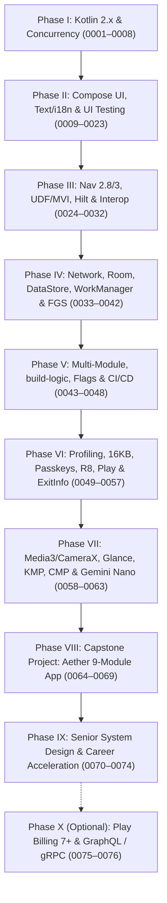

# Modern Android & KMP Engineering Master Plan (2026/2027 Standards)

> **Complete 76-Lesson Sequential Roadmap (`0001`–`0074` Core + `0075`–`0076` Optional Specializations)**  
> *Target: Junior-to-Senior Modern Android & Kotlin Multiplatform Engineer*

---

## 1. Architectural Philosophy & Study Workflow

Every lesson in this curriculum anchors into the **2026/2027 Google Modern Android & KMP Architecture (Now in Android standard)**: Kotlin 2.x (K2 FIR), 100% declarative Jetpack Compose, TextFieldState & edge-to-edge WindowInsets, Navigation 3 adaptive multi-pane scenes, Offline-First Room + Typed DataStore Single Source of Truth, Dagger Hilt (KSP), Multi-Module `build-logic` convention plugins, 2027 Play Store mandates (16 KB ELF pages, Android 17 resizability, Passkeys, Play Integrity), and Kotlin/Compose Multiplatform.

### How to Study Effectively (`/teach` + Browser + `./playground/`)
1. **Concept & Effortful Retrieval (Browser, ~15–20 min/lesson):** Launch lessons sequentially from `MASTER_PLAN.html`. Attempt the in-browser coding practice *before* clicking Hints or Reveal Answer, then complete both retrieval quizzes.
2. **Real K2 Compiler Verification (`./playground/`):** Paste or adapt your solutions into the local `./playground/` Gradle project (`JAVA_HOME="/Applications/Android Studio.app/Contents/jbr/Contents/Home" ./playground/gradlew -p playground test`) or Android Studio so real K2 type-checking, Coroutines `runTest`, and Turbine validate your code.
3. **Interactive `/teach` Check-Ins:** Ask follow-up questions in chat, request spaced-retrieval drills across prior lessons, promote mastered terms into `GLOSSARY.md`, and build `./aether/` during Phase VIII (`0064`–`0069`).

---

## 2. Master Curriculum Index (76 Sequential Lessons)

### Phase I: Modern Kotlin 2.x & Concurrency (Lessons 0001–0008)
*Mastering idiomatic Kotlin 2.x (K2 FIR compiler), sealed hierarchies, zero-cost value classes (safe minor-unit money), reified generics, context parameters, structured concurrency, and reactive Flow testing with Turbine.*

- **[Lesson 0001: Modern Kotlin 2.x Essentials for Android](lessons/0001-modern-kotlin-essentials.html)**  
  *Master the K2 compiler runtime advantages, smart cast 2.0, immutable modeling, and idiomatic scope functions.*
- **[Lesson 0002: Advanced Modeling with Sealed Hierarchies & Value Classes](lessons/0002-sealed-hierarchies-value-classes.html)**  
  *Eliminate invalid UI states with exhaustive sealed interfaces and zero-allocation @JvmInline value classes.*
- **[Lesson 0003: Extension Functions, Generics & Reified Type Parameters](lessons/0003-extension-functions-generics-reified.html)**  
  *Build ergonomic Android utility APIs and overcome JVM type erasure with inline reified generics.*
- **[Lesson 0004: Kotlin 2.x Context Parameters & Type-Safe DSLs](lessons/0004-context-parameters-dsl-builders.html)**  
  *Eliminate dependency plumbing using Kotlin 2.x context parameters and build expressive UI DSLs with @DslMarker.*
- **[Lesson 0005: Kotlin Coroutines Fundamentals & Structured Concurrency](lessons/0005-coroutines-structured-concurrency.html)**  
  *Harness structured concurrency, CPS state machines, coroutine cancellation, and error isolation.*
- **[Lesson 0006: Asynchronous Flow: Cold Streams & Transformation](lessons/0006-asynchronous-flow-cold-streams.html)**  
  *Build reactive pipelines with backpressure management, debounce, and in-flight request cancellation.*
- **[Lesson 0007: Hot Streams & State Management: StateFlow vs SharedFlow](lessons/0007-hot-streams-stateflow-sharedflow.html)**  
  *Model production UI state with StateFlow and one-off navigation/toast events with SharedFlow.*
- **[Lesson 0008: Testing Coroutines & Flows with Turbine & runTest](lessons/0008-testing-coroutines-flows-turbine.html)**  
  *Write fast, deterministic asynchronous unit tests using virtual time skipping and the Turbine library.*

---

### Phase II: Android App Anatomy, Compose UI, Text/i18n & UI Testing (Lessons 0009–0023)
*From ComponentActivity, SplashScreen, and process death survival to Compose's 3 phases, state hoisting, edge-to-edge WindowInsets, TextFieldState & per-app localization, LazyColumn, Material 3 Expressive, Modifier.Node, Strong Skipping, Canvas, accessibility, Robolectric, and Roborazzi screenshot tests.*

- **[Lesson 0009: Android App Anatomy, ComponentActivity & Process Death](lessons/0009-android-app-anatomy-activity-process-death.html)**  
  *Master the Android application lifecycle, ComponentActivity, SavedStateHandle, and surviving system process death.*
- **[Lesson 0010: The Compose Mental Model & Lifecycle](lessons/0010-compose-mental-model-lifecycle.html)**  
  *Understand declarative UI composition, the 3 phases of Compose (Composition, Layout, Draw), and smart recomposition.*
- **[Lesson 0011: State in Compose: remember, rememberSaveable & Hoisting](lessons/0011-state-remember-hoisting.html)**  
  *Master mutableStateOf, state survival across recomposition and configuration changes, and state hoisting.*
- **[Lesson 0012: Layout Primitives, Modifier Order & WindowInsets (Edge-to-Edge)](lessons/0012-layout-primitives-modifier-order-insets.html)**  
  *Master Column, Row, Box, Scaffold, modifier chaining order, and Android 15/16+ mandatory edge-to-edge window insets.*
- **[Lesson 0013: Compose Text (TextFieldState), Keyboard Insets, Focus & Localization](lessons/0013-compose-text-ime-focus-localization.html)**  
  *Eliminate async cursor-jumping bugs with TextFieldState, animate software keyboards via WindowInsets.ime, and ship RTL & per-app localized UI.*
- **[Lesson 0014: High-Performance Lists: LazyColumn & Item Animations](lessons/0014-high-performance-lists-lazycolumn.html)**  
  *Render 10,000+ items smoothly with LazyColumn, stable keys, contentType optimization, and animateItem.*
- **[Lesson 0015: Design System & Theming with Material 3 Expressive](lessons/0015-design-system-theming-material-3.html)**  
  *Implement Material You dynamic color, dark/light modes, custom design tokens, and CompositionLocal.*
- **[Lesson 0016: Compose Side-Effects: LaunchedEffect & Lifecycle](lessons/0016-compose-side-effects-launched-effect.html)**  
  *Master LaunchedEffect, rememberCoroutineScope, DisposableEffect, and rememberUpdatedState.*
- **[Lesson 0017: Advanced State Derivation & Modifier.Node API](lessons/0017-advanced-state-derivation-modifier-node.html)**  
  *Prune redundant recompositions with derivedStateOf and master high-performance Modifier.Node implementations.*
- **[Lesson 0018: Recomposition Optimization & Strong Skipping Mode](lessons/0018-recomposition-optimization-strong-skipping.html)**  
  *Master the Compose compiler metrics, @Immutable, @Stable, and Kotlin 2.x default Strong Skipping Mode.*
- **[Lesson 0019: Complex Animations & Micro-Interactions](lessons/0019-complex-animations-micro-interactions.html)**  
  *Build fluid 120fps animations using animateContentSize, AnimatedVisibility, updateTransition, and gesture physics.*
- **[Lesson 0020: Custom Canvas Drawing (DrawScope) & Gesture Handling](lessons/0020-custom-canvas-drawing-gesture-handling.html)**  
  *Draw high-performance financial charts and custom shapes with Canvas, DrawScope, and pointerInput gestures.*
- **[Lesson 0021: Compose Accessibility, Semantics & TalkBack](lessons/0021-compose-accessibility-semantics-talkback.html)**  
  *Build inclusive apps using Semantics tree, contentDescription, custom actions, and mergeDescendants.*
- **[Lesson 0022: Compose UI Testing with Robolectric & ComposeTestRule](lessons/0022-compose-ui-testing-robolectric.html)**  
  *Write blazing-fast headless UI unit tests under 500ms using createComposeRule and Robolectric.*
- **[Lesson 0023: Visual Regression & Screenshot Testing (Roborazzi / Paparazzi)](lessons/0023-screenshot-testing-roborazzi-paparazzi.html)**  
  *Catch clipped text, dark-mode contrast bugs, and tablet layout regressions in seconds on the JVM without emulators.*

---

### Phase III: Navigation, UDF/MVI Architecture, Hilt & Brownfield Interop (Lessons 0024–0032)
*Type-safe Navigation 2.8+, greenfield Navigation 3 user-owned back stacks & adaptive multi-pane scenes, shared element transitions, Unidirectional Data Flow (MVI), lifecycle-aware collection, Clean Architecture UseCases, Dagger Hilt (KSP), and incremental Fragment/View-to-Compose migration.*

- **[Lesson 0024: Jetpack Navigation Compose 2.8+ Type-Safe Routes](lessons/0024-type-safe-navigation-compose.html)**  
  *Eliminate string route parsing bugs with Kotlin Serializable route objects and type-safe argument extraction.*
- **[Lesson 0025: Modern Jetpack Navigation 3 & Adaptive Multi-Pane Layouts](lessons/0025-jetpack-navigation-3-adaptive-layouts.html)**  
  *Build declarative, user-owned back stacks with Navigation 3 (androidx.navigation3) and adapt to foldables with ListDetailPaneScaffold.*
- **[Lesson 0026: Deep Links, Backstack & Shared Element Transitions](lessons/0026-deep-links-shared-element-transitions.html)**  
  *Integrate type-safe deep links and build cinematic shared element transitions with SharedTransitionLayout.*
- **[Lesson 0027: Unidirectional Data Flow (UDF) & MVI State Architecture](lessons/0027-unidirectional-data-flow-mvi.html)**  
  *Architect rock-solid screens with Model-View-Intent (MVI), single immutable UiState, and sealed user intents.*
- **[Lesson 0028: Production ViewModels & Lifecycle-Aware State Collection](lessons/0028-viewmodel-lifecycle-aware-collection.html)**  
  *Stop background battery drain by collecting StateFlow with collectAsStateWithLifecycle.*
- **[Lesson 0029: Clean Architecture Domain Layer (When & How to Use Cases)](lessons/0029-clean-architecture-domain-usecases.html)**  
  *Encapsulate complex business rules with single-responsibility Use Cases and avoid 1:1 pass-through over-engineering.*
- **[Lesson 0030: Dependency Injection with Dagger Hilt & KSP](lessons/0030-dependency-injection-dagger-hilt-ksp.html)**  
  *Set up lightning-fast dependency injection using Dagger Hilt with Kotlin Symbol Processing (KSP).*
- **[Lesson 0031: Advanced Hilt: Qualifiers, Scopes & Test Injections](lessons/0031-advanced-hilt-qualifiers-testing.html)**  
  *Differentiate duplicate dependencies with @Qualifier, control lifecycles with Scopes, and swap test fakes with @TestInstallIn.*
- **[Lesson 0032: Brownfield Compose & View Interop (AndroidView, ComposeView & Migration)](lessons/0032-compose-view-interop-brownfield-migration.html)**  
  *Lead incremental legacy-to-Compose migrations safely with ViewCompositionStrategy, AndroidView pooling, and shared ViewModels.*

---

### Phase IV: Networking, Offline-First Persistence, WorkManager & OS Boundaries (Lessons 0033–0042)
*Reflection-free Ktor/Retrofit + kotlinx.serialization, Mutex 401 token refresh, WebSockets/SSE via callbackFlow, Paging 3 + Coil 3, Room KSP + verified migrations (MigrationTestHelper), Typed DataStore, Offline-First SSOT repositories, WorkManager, Predictive Back, Photo Picker, and Typed Foreground Services.*

- **[Lesson 0033: Modern Networking with Ktor / Retrofit + kotlinx.serialization](lessons/0033-modern-networking-ktor-retrofit-serialization.html)**  
  *Build reflection-free, lightning-fast REST clients using Ktor/Retrofit and Kotlinx Serialization.*
- **[Lesson 0034: Resilient Interceptors & OAuth2 Token Auto-Refresh](lessons/0034-resilient-interceptors-token-refresh.html)**  
  *Handle 401 Unauthorized responses with Mutex synchronization to eliminate concurrent token refresh race conditions.*
- **[Lesson 0035: Real-Time Networking: WebSockets & SSE with Flow](lessons/0035-realtime-networking-websockets-flow.html)**  
  *Bridge bidirectional WebSockets and Server-Sent Events into reactive Kotlin Flows with callbackFlow.*
- **[Lesson 0036: Pagination & Asynchronous Media: Paging 3 + Coil 3](lessons/0036-pagination-media-paging3-coil3.html)**  
  *Stream infinite datasets without OutOfMemory crashes using Paging 3, RemoteMediator, and Coil 3 image loading.*
- **[Lesson 0037: Room Database with KSP: Entities, DAOs & Relations](lessons/0037-room-database-ksp-entities-relations.html)**  
  *Model SQLite schemas with Room 2.7+ using KSP, 1:N relations, indices, and foreign keys.*
- **[Lesson 0038: Reactive Room Queries & Database Migrations](lessons/0038-reactive-room-queries-database-migrations.html)**  
  *Stream database updates automatically with Flow<List<T>> and execute non-destructive database migrations.*
- **[Lesson 0039: Jetpack DataStore: Proto DataStore vs Preferences](lessons/0039-jetpack-datastore-proto-vs-preferences.html)**  
  *Replace deprecated SharedPreferences with transactional, non-blocking Preferences DataStore and Proto DataStore.*
- **[Lesson 0040: Offline-First Repository Pattern (Single Source of Truth)](lessons/0040-offline-first-repository-ssot.html)**  
  *Architect resilient offline-first data engines where the local database is the Single Source of Truth (SSOT).*
- **[Lesson 0041: Background Processing with Jetpack WorkManager](lessons/0041-background-processing-workmanager.html)**  
  *Schedule battery-conscious offline synchronization tasks using WorkManager and CoroutineWorker.*
- **[Lesson 0042: Predictive Back, Modern Permissions & Foreground Service Types](lessons/0042-predictive-back-permissions-foreground-services.html)**  
  *Replace broken legacy back overrides, drop broad storage permissions with Photo Picker, and declare compliant typed Foreground Services.*

---

### Phase V: Multi-Module Engineering, Build Logic, Feature Flags & CI/CD (Lessons 0043–0048)
*Enterprise feature-vs-core modularization with ABI compilation avoidance, Gradle Version Catalogs (libs.versions.toml), build-logic convention plugins, Detekt & custom Compose Lint rules, GitHub Actions CI/CD with Gradle Managed Devices, and multi-module Feature Flag & Analytics architecture.*

- **[Lesson 0043: Enterprise Multi-Module Architecture (Feature vs Core)](lessons/0043-enterprise-multi-module-architecture.html)**  
  *Scale Android codebases to 50+ engineers with strict module isolation and parallel Gradle compilation.*
- **[Lesson 0044: Gradle Version Catalogs (libs.versions.toml)](lessons/0044-gradle-version-catalogs.html)**  
  *Centralize and standardize dependencies across 30+ modules with Gradle Version Catalogs and bundles.*
- **[Lesson 0045: Gradle Convention Plugins with build-logic](lessons/0045-gradle-convention-plugins-build-logic.html)**  
  *Eliminate 500+ lines of duplicate build.gradle.kts boilerplate using custom Kotlin DSL convention plugins in build-logic.*
- **[Lesson 0046: Static Code Analysis & Code Health: Detekt & Lint](lessons/0046-static-analysis-detekt-lint.html)**  
  *Enforce strict Kotlin code health, detect architectural leaks, and enforce Compose rules with Detekt and Android Lint.*
- **[Lesson 0047: Automated CI/CD Pipelines with GitHub Actions](lessons/0047-ci-cd-github-actions.html)**  
  *Build blazing-fast CI/CD pipelines that run unit tests, linting, Gradle caching, and release APK/AAB generation.*
- **[Lesson 0048: Production Rollouts: Feature Flags, Remote Config & Analytics Architecture](lessons/0048-feature-flags-analytics-experimentation-scale.html)**  
  *Design multi-module feature flag evaluation, QA debug override panels, staged rollout hydration, and decoupled analytics pipelines.*

---

### Phase VI: Profiling, 2027 Mandates, Security/Passkeys, Release & Observability (Lessons 0049–0057)
*120Hz Perfetto CPU profiling & StrictMode, Baseline Profiles & Macrobenchmark, LeakCanary heap forensics, Feb 2027 16 KB ELF page alignment & Android 17 adaptive resizability, Hardware Keystore Biometrics, Credential Manager (Passkeys) & Play Integrity, R8 Full Mode, Play AAB release, and ApplicationExitInfo ANR/LMK forensics.*

- **[Lesson 0049: Android Performance Profiling: CPU & Systrace](lessons/0049-android-performance-profiling-cpu-systrace.html)**  
  *Eliminate 16ms frame drops using Android Studio Profiler, Perfetto traces, and CPU thread contention analysis.*
- **[Lesson 0050: Baseline Profiles & Jetpack Macrobenchmark](lessons/0050-baseline-profiles-macrobenchmark.html)**  
  *Slash cold app startup times by 40%+ using ahead-of-time (AOT) Baseline Profiles and Macrobenchmark tests.*
- **[Lesson 0051: Memory Leak Detection with LeakCanary](lessons/0051-memory-leak-detection-leakcanary.html)**  
  *Track GC roots, detect retained Activity/Context instances, and eliminate memory leaks with LeakCanary.*
- **[Lesson 0052: Android 16/17 Mandates: 16 KB Pages & Adaptive Resizability](lessons/0052-android-16-17-mandates-16kb-adaptive.html)**  
  *Satisfy hard Google Play 2027 binary requirements: 16 KB ELF page alignment and non-negotiable large-screen adaptive layouts.*
- **[Lesson 0053: Android Hardware Security & Biometrics](lessons/0053-android-hardware-security-biometrics.html)**  
  *Protect sensitive cryptographic keys using Android Keystore (StrongBox/TEE) and BiometricPrompt authentication.*
- **[Lesson 0054: Unified Auth & Trust: Credential Manager & Play Integrity](lessons/0054-credential-manager-play-integrity.html)**  
  *Implement Passkeys with Credential Manager, retire deprecated EncryptedSharedPreferences, and enforce server-verified Play Integrity.*
- **[Lesson 0055: ProGuard & R8 Full Mode Optimization](lessons/0055-proguard-r8-optimization.html)**  
  *Shrink APK size by 40%+, eliminate unused code, and write safe keep rules with R8 Full Mode.*
- **[Lesson 0056: Google Play Release & Android App Bundles (AAB)](lessons/0056-google-play-release-android-app-bundles.html)**  
  *Prepare production Android App Bundles (.aab), configure Play App Signing, and monitor Android Vitals.*
- **[Lesson 0057: Production Observability: ApplicationExitInfo, ANRs & Staged Rollouts](lessons/0057-production-observability-exit-info-anrs.html)**  
  *Diagnose silent OOM/LMK kills and ANRs via ApplicationExitInfo, and ship safely using staged rollouts and remote kill switches.*

---

### Phase VII: Rich Media, System Surfaces, KMP/CMP & On-Device AI (Lessons 0058–0063)
*Single-player pooled Jetpack Media3 (ExoPlayer) & CameraX pipelines, Jetpack Glance App Widgets & Android 16/17 Promoted Live Updates via FCM data push, Kotlin Multiplatform (:shared Ktor, Room KMP, Koin, SKIE), Compose Multiplatform (CMP UIKitView & composeResources), and Android AICore (Gemini Nano).*

- **[Lesson 0058: Rich Media Engineering: Jetpack Media3 (ExoPlayer) & CameraX Pipelines](lessons/0058-media3-exoplayer-camerax-architecture.html)**  
  *Architect TikTok-grade video feeds with ExoPlayer instance pooling, CacheDataSource pre-warming, MediaSessionService, and CameraX UseCases.*
- **[Lesson 0059: System Surfaces: Jetpack Glance App Widgets & Android 16/17 Live Updates](lessons/0059-jetpack-glance-widgets-live-updates.html)**  
  *Extend app engagement to the home screen and lock screen with GlanceAppWidget, RemoteViews composition trees, and Promoted Ongoing Notifications.*
- **[Lesson 0060: Kotlin Multiplatform (KMP): Architecture, expect/actual & Shared Logic](lessons/0060-kotlin-multiplatform-architecture-shared-logic.html)**  
  *Share domain models, validation, and repositories across Android and iOS natively without leaking platform dependencies into commonMain.*
- **[Lesson 0061: KMP Production Stack: Ktor, Room KMP, DataStore & Koin](lessons/0061-kmp-production-stack-ktor-room-koin.html)**  
  *Assemble an offline-first multiplatform data layer using Ktor engines, Jetpack Room KMP with BundledSQLiteDriver, DataStore, and Koin DI.*
- **[Lesson 0062: Compose Multiplatform (CMP): Shared UI, Resources & Native Interop](lessons/0062-compose-multiplatform-shared-ui-architecture.html)**  
  *Architect shared @Composable screens across Android and iOS using composeResources, ComposeUIViewController, and UIKitView interop.*
- **[Lesson 0063: On-Device Generative AI: Android AICore, Gemini Nano & Hybrid Routing](lessons/0063-on-device-ai-aicore-gemini-nano.html)**  
  *Deliver zero-egress, offline-capable LLM summarization and rewriting with Android AICore, ML Kit GenAI APIs, and capability fallbacks.*

---

### Phase VIII: The Capstone Project: "Aether" Production App (Lessons 0064–0069)
*Engineering the resume-defining 9-module financial intelligence app end-to-end: Navigation 3 adaptive panes, UsdMicros safe currency types, custom Material 3 finance tokens, micro-batched Ktor WebSocket + Room SSOT sync, 120fps candlestick Canvas + Biometric Vault, 5-layer test pyramid (Turbine, Robolectric, Roborazzi, Maestro), and 16 KB + Baseline Profile CI release.*

- **[Lesson 0064: Aether: Multi-Module Architecture & System Blueprint](lessons/0064-aether-architecture-specifications.html)**  
  *Product specifications, 9-module dependency graph, Navigation 3 adaptive scenes, UsdMicros financial types, and Room SSOT schema.*
- **[Lesson 0065: Aether: Core Infrastructure & Design System Modules](lessons/0065-aether-core-designsystem-modules.html)**  
  *Build the shared design tokens, custom buttons, cards, and theme infrastructure in :core:designsystem.*
- **[Lesson 0066: Aether: Real-Time Telemetry & Offline Cache Engine](lessons/0066-aether-realtime-telemetry-room-sync.html)**  
  *Bridge live WebSocket market updates into Room database cache and schedule periodic WorkManager sync.*
- **[Lesson 0067: Aether: Interactive Candlestick Canvas & Biometric Vault](lessons/0067-aether-features-charts-biometric-vault.html)**  
  *Implement custom candlestick stock charts with scrubber gestures and the hardware-encrypted Biometric Vault.*
- **[Lesson 0068: Aether: Automated Testing Suite (MockK, Turbine, Maestro)](lessons/0068-aether-testing-suite-mockk-turbine-maestro.html)**  
  *Achieve 85%+ test coverage across the capstone project using MockK, Turbine, Robolectric, and Maestro E2E.*
- **[Lesson 0069: Aether: Production Hardening, Baseline Profiles & CI/CD](lessons/0069-aether-production-hardening-release.html)**  
  *Bundle generated Baseline Profiles, tune ProGuard R8 keep rules, and automate release publishing via GitHub Actions.*

---

### Phase IX: Career Acceleration & Senior System Design (Lessons 0070–0074)
*Converting mastery into top-tier offers: the 4-Phase Mobile System Design framework, Android OS internals (Zygote, Binder IPC, Looper, Choreographer), staff-level code reviews & incident ownership, XYZ/STAR portfolio presentation, and live coding defense tactics.*

- **[Lesson 0070: Android System Design Interviews: Framework & Execution](lessons/0070-android-system-design-interviews-framework.html)**  
  *Master the 4-phase mobile system design interview framework: Scope, Architecture, Deep Dives, and Tradeoffs.*
- **[Lesson 0071: Android OS Internals Deep Dive for Interviews](lessons/0071-android-os-internals-deep-dive.html)**  
  *Master the Linux kernel, Zygote process forking, Binder IPC, Looper/Handler queues, and Choreographer VSYNC.*
- **[Lesson 0072: Junior-to-Senior Transition: Production Ownership & Code Reviews](lessons/0072-junior-to-senior-production-ownership.html)**  
  *Accelerate your career: write high-converting PRs, conduct staff-level code reviews, and handle production incidents.*
- **[Lesson 0073: Resume Crafting & GitHub Portfolio Showcase](lessons/0073-resume-crafting-portfolio-showcase.html)**  
  *Convert your skills into offers: write high-impact STAR resume bullets and structure a GitHub portfolio that thrills hiring managers.*
- **[Lesson 0074: Live Coding & Technical Defense Tactics](lessons/0074-live-coding-interview-tactics.html)**  
  *Tackle live coding rounds (Compose layouts, Coroutine bug hunts, Flow debounce pipelines) and behavioral leadership scenarios.*

---

### Phase X: Optional Specializations — Monetization & Schema-First APIs (Lessons 0075–0076)
*High-leverage domain specializations for consumer subscription apps and schema-driven Big Tech stacks: tamper-proof Google Play Billing 7+ entitlements (server token verification, RTDN webhooks, 3-day acknowledgment) and GraphQL (Apollo Kotlin 4 normalized caching) + gRPC / Protobuf streaming.*

- **[Lesson 0075: Google Play Billing 7+, Subscriptions & Entitlement Architecture](lessons/0075-google-play-billing-subscriptions-monetization.html)** *(Optional Specialization)*  
  *Engineer tamper-proof in-app subscriptions with BillingClient coroutines, backend purchaseToken verification, RTDN webhooks, and 3-day acknowledgment.*
- **[Lesson 0076: Schema-First Mobile APIs: GraphQL (Apollo Kotlin 4) & gRPC / Protobuf](lessons/0076-graphql-apollo-kotlin-grpc-protobuf.html)** *(Optional Specialization)*  
  *Eliminate REST over-fetching with Apollo Kotlin 4 normalized caching and stream low-latency binary RPCs with gRPC-Kotlin and Wire.*

---

## 3. Printable Desk Cheat Sheets (`./reference/`)

1. **[01-kotlin-coroutines-flow.html](reference/01-kotlin-coroutines-flow.html)**: Scope functions matrix, Dispatchers, Cold vs Hot Flows, minor-unit money rule, and reactive pipelines.
2. **[02-jetpack-compose-m3.html](reference/02-jetpack-compose-m3.html)**: Side-effects guide, Modifier order, Strong Skipping matrix, `installSplashScreen()`, and `TextFieldState`.
3. **[03-modern-android-architecture.html](reference/03-modern-android-architecture.html)**: Dagger Hilt scopes, Single Source of Truth flow, Navigation 3, `MigrationTestHelper`, and multi-module ABI rules.
4. **[04-2027-senior-mandates-and-kmp.html](reference/04-2027-senior-mandates-and-kmp.html)**: 16 KB alignment & Android 17 checks, Credential Manager & Play Integrity, `ApplicationExitInfo`, KMP/CMP stack, and Optional Specializations.
5. **[05-glossary.html](reference/05-glossary.html)**: Complete searchable & printable 2027 Android & KMP Engineering Glossary across Phases I–X.
