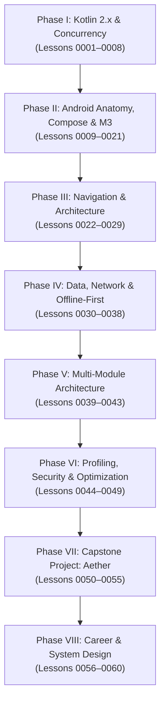

# Modern Android Engineering Master Plan (2026/2027 Standards)

> **Legend & Syllabus for End-to-End Modern Android Development with Kotlin**  
> *Target: From Foundations to Job-Ready Production Android Engineer (Junior-to-Senior Pathway)*

---

## 1. Architectural Philosophy & The 2026/2027 Tech Standard

Modern Android Development (MAD) has undergone a tectonic shift. Legacy patterns (XML layouts, RxJava, AsyncTask, Fragments, Moshi/Gson, DataBinding, string-based navigation, single-module monoliths) are obsolete in modern high-performance engineering teams.

This curriculum follows the **2026/2027 Google Modern Android Architecture (Now in Android standard)**:

```
┌────────────────────────────────────────────────────────────────────────┐
│                          UI LAYER                                      │
│  Jetpack Compose + Material 3 Expressive + Navigation 3 / 2.8+         │
│  StateFlow<UiState> ──(Collect with Lifecycle)──> Stateless Composables │
├────────────────────────────────────────────────────────────────────────┤
│                         DOMAIN LAYER (Optional/Enterprise)             │
│  UseCases (Single Responsibility, operator fun invoke, Domain Models)  │
├────────────────────────────────────────────────────────────────────────┤
│                          DATA LAYER (Offline-First)                    │
│  Repository Pattern (Single Source of Truth)                           │
│  ┌───────────────────────────────┬──────────────────────────────────┐  │
│  │ Local Data Source             │ Remote Data Source               │  │
│  │ Room (KSP) + DataStore Proto  │ Ktor / Retrofit + kotlinx.ser.   │  │
│  │ Reactive Flow Cache           │ WebSockets / SSE / HTTP/3        │  │
│  └───────────────────────────────┴──────────────────────────────────┘  │
├────────────────────────────────────────────────────────────────────────┤
│                       BACKGROUND & SYNC                                │
│  Jetpack WorkManager (CoroutineWorker, Expedited, Constraints)         │
├────────────────────────────────────────────────────────────────────────┤
│               CROSS-CUTTING FOUNDATION (Core & Build)                  │
│  Kotlin 2.x + Coroutines + Dagger Hilt (KSP) + Baseline Profiles       │
│  Gradle Version Catalogs + Kotlin DSL Convention Plugins (build-logic) │
└────────────────────────────────────────────────────────────────────────┘
```

---

## 2. Master Curriculum Index (60 Lessons)



---

### Phase I: Modern Kotlin 2.x & Foundational Architecture (Lessons 0001–0008)
*Mastering idiomatic, high-performance Kotlin 2.x, functional paradigms, and structured concurrency.*

- **[Lesson 0001: Modern Kotlin 2.x Essentials for Android](lessons/0001-modern-kotlin-essentials.html)**  
  *Concepts:* K2 compiler runtime advantages, smart cast 2.0, immutability, scope functions (`let`, `apply`, `also`, `run`).
- **[Lesson 0002: Advanced Modeling with Sealed Hierarchies & Value Classes](lessons/0002-sealed-hierarchies-value-classes.html)**  
  *Concepts:* Exhaustive state modeling with `sealed interface`, zero-allocation domain primitives via `@JvmInline value class`.
- **[Lesson 0003: Extension Functions, Generics & Reified Type Parameters](lessons/0003-extension-functions-generics-reified.html)**  
  *Concepts:* Type erasure on the JVM, `inline fun <reified T>`, type-safe extension utility libraries.
- **[Lesson 0004: Kotlin 2.x Context Parameters & Type-Safe DSLs](lessons/0004-context-parameters-dsl-builders.html)**  
  *Concepts:* Context parameters, type-safe DSL builders with `@DslMarker`.
- **[Lesson 0005: Kotlin Coroutines Fundamentals & Structured Concurrency](lessons/0005-coroutines-structured-concurrency.html)**  
  *Concepts:* CPS state machine, structured concurrency, `coroutineScope` vs `supervisorScope`.
- **[Lesson 0006: Asynchronous Flow (Cold Streams & Transformation)](lessons/0006-asynchronous-flow-cold-streams.html)**  
  *Concepts:* Cold streams, backpressure, debounced autocomplete with `flatMapLatest`.
- **[Lesson 0007: Hot Streams & State Management (StateFlow & SharedFlow)](lessons/0007-hot-streams-stateflow-sharedflow.html)**  
  *Concepts:* `StateFlow` (UI state) vs `SharedFlow` (one-off events), `SharingStarted.WhileSubscribed(5_000)`.
- **[Lesson 0008: Testing Coroutines & Flows with Turbine & runTest](lessons/0008-testing-coroutines-flows-turbine.html)**  
  *Concepts:* Virtual time advancement in `runTest`, sequential emission assertions with Turbine.

---

### Phase II: Android App Anatomy, Compose & Material 3 (Lessons 0009–0021)
*From OS activity lifecycle and edge-to-edge drawing to high-performance Compose UI.*

- **[Lesson 0009: Android App Anatomy, ComponentActivity & Process Death](lessons/0009-android-app-anatomy-activity-process-death.html)**  
  *Concepts:* `ComponentActivity`, configuration changes vs system-initiated process death, `SavedStateHandle`.
- **[Lesson 0010: The Compose Mental Model & Lifecycle](lessons/0010-compose-mental-model-lifecycle.html)**  
  *Concepts:* Declarative UI paradigm, the 3 phases of Compose (Composition, Layout, Draw), smart recomposition.
- **[Lesson 0011: State in Compose: remember, rememberSaveable & Hoisting](lessons/0011-state-remember-hoisting.html)**  
  *Concepts:* `mutableStateOf`, `remember` vs `rememberSaveable`, unidirectional state hoisting.
- **[Lesson 0012: Layout Primitives, Modifier Order & WindowInsets (Edge-to-Edge)](lessons/0012-layout-primitives-modifier-order-insets.html)**  
  *Concepts:* `Column`, `Row`, `Box`, `Scaffold`, modifier chaining order, mandatory Android 15/16+ `WindowInsets.safeDrawing`.
- **[Lesson 0013: High-Performance Lists: LazyColumn & Item Animations](lessons/0013-high-performance-lists-lazycolumn.html)**  
  *Concepts:* Viewport node recycling, stable keys, `contentType` layout reuse, `animateItem`.
- **[Lesson 0014: Design System & Theming with Material 3 Expressive](lessons/0014-design-system-theming-material-3.html)**  
  *Concepts:* Material You dynamic color, dark/light themes, custom design tokens, `CompositionLocal`.
- **[Lesson 0015: Compose Side-Effects: LaunchedEffect & Lifecycle](lessons/0015-compose-side-effects-launched-effect.html)**  
  *Concepts:* Side-effect lifecycles: `LaunchedEffect`, `rememberCoroutineScope`, `DisposableEffect`, `rememberUpdatedState`.
- **[Lesson 0016: Advanced State Derivation & Modifier.Node API](lessons/0016-advanced-state-derivation-modifier-node.html)**  
  *Concepts:* Dampening high-frequency recompositions with `derivedStateOf`, high-performance custom `Modifier.Node`.
- **[Lesson 0017: Recomposition Optimization & Strong Skipping Mode](lessons/0017-recomposition-optimization-strong-skipping.html)**  
  *Concepts:* Strong Skipping Mode (Kotlin 2.0+ default: `===` vs `equals()`), `@Immutable`, `@Stable`, avoiding collection allocation traps.
- **[Lesson 0018: Complex Animations & Micro-Interactions](lessons/0018-complex-animations-micro-interactions.html)**  
  *Concepts:* Physics-based springs, `AnimatedVisibility`, `Modifier.animateContentSize()`, coordinated transitions.
- **[Lesson 0019: Custom Canvas Drawing (DrawScope) & Gesture Handling](lessons/0019-custom-canvas-drawing-gesture-handling.html)**  
  *Concepts:* Hardware-accelerated Skia 2D rendering, financial candlestick charts in `DrawScope`, touch scrubbers with `pointerInput`.
- **[Lesson 0020: Compose Accessibility, Semantics & TalkBack](lessons/0020-compose-accessibility-semantics-talkback.html)**  
  *Concepts:* The Semantics Tree, TalkBack screen readers, `48.dp` minimum touch targets, `mergeDescendants`.
- **[Lesson 0021: Compose UI Testing with Robolectric & ComposeTestRule](lessons/0021-compose-ui-testing-robolectric.html)**  
  *Concepts:* Headless JVM UI tests under 500ms, finders, actions, and assertions via `ComposeTestRule`.

---

### Phase III: Navigation, Architecture & State Engineering (Lessons 0022–0029)
*Architecting enterprise applications with Unidirectional Data Flow and type safety.*

- **[Lesson 0022: Jetpack Navigation Compose 2.8+ Type-Safe Routes](lessons/0022-type-safe-navigation-compose.html)**  
  *Concepts:* Type-safe navigation using `@Serializable` route objects and data classes, eliminating string URLs.
- **[Lesson 0023: Modern Jetpack Navigation 3 & Adaptive Multi-Pane Layouts](lessons/0023-jetpack-navigation-3-adaptive-layouts.html)**  
  *Concepts:* `androidx.navigation3` user-owned back stacks (`rememberNavBackStack`), `NavDisplay`, adaptive multi-pane foldables.
- **[Lesson 0024: Deep Links, Backstack & Shared Element Transitions](lessons/0024-deep-links-shared-element-transitions.html)**  
  *Concepts:* Type-safe deep linking, `SharedTransitionLayout`, shared bounds element transitions.
- **[Lesson 0025: Unidirectional Data Flow (UDF) & MVI State Architecture](lessons/0025-unidirectional-data-flow-mvi.html)**  
  *Concepts:* Model-View-Intent (MVI), single immutable `UiState`, sealed user intents, reducer functions.
- **[Lesson 0026: Production ViewModels & Lifecycle-Aware State Collection](lessons/0026-viewmodel-lifecycle-aware-collection.html)**  
  *Concepts:* `SavedStateHandle`, collecting StateFlow safely with `collectAsStateWithLifecycle()` to prevent background battery drain.
- **[Lesson 0027: Clean Architecture Domain Layer (When & How to Use Cases)](lessons/0027-clean-architecture-domain-usecases.html)**  
  *Concepts:* Reusable business rules, `operator fun invoke()`, avoiding the 1:1 pass-through anti-pattern.
- **[Lesson 0028: Dependency Injection with Dagger Hilt & KSP](lessons/0028-dependency-injection-dagger-hilt-ksp.html)**  
  *Concepts:* `@HiltAndroidApp`, `@AndroidEntryPoint`, `@HiltViewModel`, `@Binds` vs `@Provides`, KSP speed boost.
- **[Lesson 0029: Advanced Hilt: Qualifiers, Scopes & Test Injections](lessons/0029-advanced-hilt-qualifiers-testing.html)**  
  *Concepts:* Custom `@Qualifier` annotations, component scopes, swapping test fakes with `@TestInstallIn`.

---

### Phase IV: Networking, Offline-First Persistence & Sync (Lessons 0030–0038)
*Engineering resilient, offline-first data engines that never lose user state.*

- **[Lesson 0030: Modern Networking with Ktor / Retrofit + kotlinx.serialization](lessons/0030-modern-networking-ktor-retrofit-serialization.html)**  
  *Concepts:* Reflection-free compile-time JSON parsing, `@Serializable`, `@SerialName`.
- **[Lesson 0031: Resilient Interceptors & OAuth2 Token Auto-Refresh](lessons/0031-resilient-interceptors-token-refresh.html)**  
  *Concepts:* Mutex synchronization to eliminate concurrent 401 token refresh race conditions.
- **[Lesson 0032: Real-Time Networking: WebSockets & SSE with Flow](lessons/0032-realtime-networking-websockets-flow.html)**  
  *Concepts:* Bridging callback-based WebSocket connections into reactive Flows via `callbackFlow` and `awaitClose`.
- **[Lesson 0033: Pagination & Asynchronous Media: Paging 3 + Coil 3](lessons/0033-pagination-media-paging3-coil3.html)**  
  *Concepts:* Infinite pagination with `PagingSource`, `RemoteMediator` database caching, and Coil 3 image loading.
- **[Lesson 0034: Room Database with KSP: Entities, DAOs & Relations](lessons/0034-room-database-ksp-entities-relations.html)**  
  *Concepts:* Room with KSP, `@Entity`, `@PrimaryKey`, `@Upsert`, `@Relation`, foreign keys, `@Transaction`.
- **[Lesson 0035: Reactive Room Queries & Database Migrations](lessons/0035-reactive-room-queries-database-migrations.html)**  
  *Concepts:* Observable database queries with `Flow<List<T>>`, InvalidationTracker, non-destructive migrations.
- **[Lesson 0036: Jetpack DataStore: Proto DataStore vs Preferences](lessons/0036-jetpack-datastore-proto-vs-preferences.html)**  
  *Concepts:* Why SharedPreferences causes ANRs, transactional asynchronous Preferences DataStore and Proto DataStore.
- **[Lesson 0037: Offline-First Repository Pattern (Single Source of Truth)](lessons/0037-offline-first-repository-ssot.html)**  
  *Concepts:* Single Source of Truth (SSOT), network-as-a-sync-mechanism, instant offline launches.
- **[Lesson 0038: Background Work & Offline Sync with Jetpack WorkManager](lessons/0038-background-processing-workmanager.html)**  
  *Concepts:* `CoroutineWorker`, execution constraints (`UNMETERED`, `BATTERY_NOT_LOW`), exponential backoff retries.

---

### Phase V: Multi-Module Engineering & Enterprise Build Logic (Lessons 0039–0043)
*Scaling codebases to dozens of engineers with fast compilation and strict boundaries.*

- **[Lesson 0039: Enterprise Multi-Module Architecture (Feature vs Core)](lessons/0039-enterprise-multi-module-architecture.html)**  
  *Concepts:* Decoupled feature modules, strict dependency inversion, pure `:core:model`.
- **[Lesson 0040: Gradle Version Catalogs (libs.versions.toml)](lessons/0040-gradle-version-catalogs.html)**  
  *Concepts:* Centralized dependency management, version catalogs, bundles, plugin aliases.
- **[Lesson 0041: Gradle Convention Plugins with build-logic](lessons/0041-gradle-convention-plugins-build-logic.html)**  
  *Concepts:* Included build `build-logic`, custom Kotlin DSL convention plugins replacing duplicate build scripts.
- **[Lesson 0042: Static Code Analysis & Code Health: Detekt & Lint](lessons/0042-static-analysis-detekt-lint.html)**  
  *Concepts:* Detekt, custom Compose lint rules, blocking dirty pull requests automatically in CI.
- **[Lesson 0043: Automated CI/CD Pipelines with GitHub Actions](lessons/0043-ci-cd-github-actions.html)**  
  *Concepts:* Continuous Integration: build verification, unit tests, Gradle build cache optimization via `setup-gradle`.

---

### Phase VI: Performance Profiling, Security & Production Hardening (Lessons 0044–0049)
*Transforming good apps into top-tier, crash-free, secure applications.*

- **[Lesson 0044: Android Performance Profiling: CPU & Systrace](lessons/0044-android-performance-profiling-cpu-systrace.html)**  
  *Concepts:* Android Studio CPU Profiler, Perfetto system traces, custom trace sections, 8.3ms frame budget.
- **[Lesson 0045: Baseline Profiles & Jetpack Macrobenchmark](lessons/0045-baseline-profiles-macrobenchmark.html)**  
  *Concepts:* Ahead-of-time (AOT) compilation, generating baseline profiles with Macrobenchmark for 40%+ faster cold starts.
- **[Lesson 0046: Memory Leak Detection with LeakCanary](lessons/0046-memory-leak-detection-leakcanary.html)**  
  *Concepts:* Garbage collection mechanics, GC roots, tracking retained Activity instances with LeakCanary.
- **[Lesson 0047: Android Hardware Security & Biometrics](lessons/0047-android-hardware-security-biometrics.html)**  
  *Concepts:* Android Keystore (StrongBox / TEE), AES-256 GCM encryption, `BiometricPrompt.CryptoObject`.
- **[Lesson 0048: ProGuard & R8 Full Mode Optimization](lessons/0048-proguard-r8-optimization.html)**  
  *Concepts:* R8 Full Mode, dead-code tree shaking, obfuscation, keep rules, de-obfuscating crash traces with `mapping.txt`.
- **[Lesson 0049: Google Play Release & Android App Bundles (AAB)](lessons/0049-google-play-release-android-app-bundles.html)**  
  *Concepts:* Android App Bundle (.aab), dynamic delivery, Google Play App Signing, Android Vitals monitoring.

---

### Phase VII: The Capstone Project: "Aether" (Lessons 0050–0055)
*Building the resume-defining, job-winning portfolio project.*

- **[Lesson 0050: Aether: Multi-Module Architecture & System Blueprint](lessons/0050-aether-architecture-specifications.html)**  
  *Deliverable:* Architecture design document, 8-module dependency graph, API specs, database schema.
- **[Lesson 0051: Aether: Core Infrastructure & Design System Modules](lessons/0051-aether-core-designsystem-modules.html)**  
  *Deliverable:* `:core:designsystem`, `:core:network`, `:core:database`, `:core:model` with convention plugins.
- **[Lesson 0052: Aether: Real-Time Telemetry & Offline Cache Engine](lessons/0052-aether-realtime-telemetry-room-sync.html)**  
  *Deliverable:* Live WebSocket price streams + Room database cache + WorkManager sync worker.
- **[Lesson 0053: Aether: Interactive Candlestick Canvas & Biometric Vault](lessons/0053-aether-features-charts-biometric-vault.html)**  
  *Deliverable:* Markets dashboard, interactive candlestick charts, portfolio tracker, biometric vault.
- **[Lesson 0054: Aether: Automated Testing Suite (MockK, Turbine, Maestro)](lessons/0054-aether-testing-suite-mockk-turbine-maestro.html)**  
  *Deliverable:* Comprehensive unit tests (MockK/Turbine), Robolectric UI tests, Maestro E2E test scripts.
- **[Lesson 0055: Aether: Production Hardening, Baseline Profiles & CI/CD](lessons/0055-aether-production-hardening-release.html)**  
  *Deliverable:* Baseline profiles bundled, R8 optimization, GitHub Actions CI/CD shipping release AAB.

---

### Phase VIII: Career Acceleration & Senior System Design (Lessons 0056–0060)
*Translating your skills into offers at top tech companies.*

- **[Lesson 0056: Android System Design Interviews: Framework & Execution](lessons/0056-android-system-design-interviews-framework.html)**  
  *Concepts:* 4-Phase System Design rubric (Scope, Architecture, Deep Dives, Tradeoffs).
- **[Lesson 0057: Android OS Internals Deep Dive for Interviews](lessons/0057-android-os-internals-deep-dive.html)**  
  *Concepts:* Zygote process forking, Binder IPC, Looper / Handler / MessageQueue, Choreographer VSYNC.
- **[Lesson 0058: Junior-to-Mid/Senior Transition: Production Ownership & Code Reviews](lessons/0058-junior-to-senior-production-ownership.html)**  
  *Concepts:* Pull request best practices, staff-level code reviews, risk mitigation, and production incident response.
- **[Lesson 0059: Resume Crafting & GitHub Portfolio Showcase](lessons/0059-resume-crafting-portfolio-showcase.html)**  
  *Concepts:* XYZ / STAR formula resume bullets, GitHub README portfolio polish with demo videos and architecture diagrams.
- **[Lesson 0060: Live Coding & Technical Defense Tactics](lessons/0060-live-coding-interview-tactics.html)**  
  *Concepts:* Thinking out loud, proactive edge-case testing, accepting hints, and handling behavioral leadership scenarios.

---

## 3. Printable Cheat Sheets & Reference Sheets

The `./reference/` directory contains standalone, printable cheat sheets for your desk:

1. **[01-kotlin-coroutines-flow.html](reference/01-kotlin-coroutines-flow.html)**: Scope functions decision matrix, Dispatchers, Cold vs Hot Flows, and reactive pipelines.
2. **[02-jetpack-compose-m3.html](reference/02-jetpack-compose-m3.html)**: Side-effects guide, Modifier order golden rule, Strong Skipping matrix, and WindowInsets checklist.
3. **[03-modern-android-architecture.html](reference/03-modern-android-architecture.html)**: Dagger Hilt scopes, Single Source of Truth flow, WorkManager rules, and multi-module dependency boundaries.
